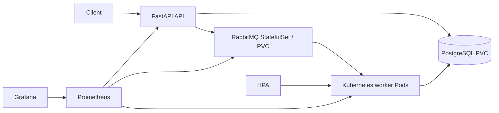

# CloudPulse

CloudPulse is a local cloud-native transaction-processing demonstration: FastAPI records idempotent transactions in PostgreSQL, RabbitMQ buffers work, and Kubernetes worker Pods process it asynchronously.



PostgreSQL is the durable transaction system of record (`postgres-data` PVC). RabbitMQ is a single-replica StatefulSet with stable `rabbitmq-0` identity and the `rabbitmq-data` PVC mounted at `/var/lib/rabbitmq`; durable queues and persistent messages therefore survive a broker Pod recreation. Failed worker deliveries flow through the one-second retry queue and, after the retry budget, to the final DLQ.

## Run on kind

```sh
docker build -t cloudpulse:dev .
kind load docker-image cloudpulse:dev --name cloudpulse
kubectl apply -f k8s/cloudpulse.yaml
kubectl apply -f https://github.com/kubernetes-sigs/metrics-server/releases/latest/download/components.yaml
kubectl -n kube-system patch deployment metrics-server --type=json -p='[{"op":"add","path":"/spec/template/spec/containers/0/args/-","value":"--kubelet-insecure-tls"}]'
kubectl apply -f k8s/monitoring.yaml
kubectl -n cloudpulse rollout status deployment/cloudpulse-api
kubectl -n cloudpulse rollout status deployment/cloudpulse-worker
kubectl -n cloudpulse port-forward service/cloudpulse-api 8000:80
```

In a second terminal:

```sh
curl -X POST http://127.0.0.1:8000/transactions \
  -H 'Content-Type: application/json' -H 'Idempotency-Key: example-1' \
  -d '{"amount_cents":100,"description":"example"}'
python tools/load_test.py --requests 100 --concurrency 10
```

## Operations

The API has `/health/live`, `/health/ready`, and `/metrics`; workers expose Prometheus metrics on port 9100. `k8s/monitoring.yaml` deploys Prometheus and Grafana and provisions the **CloudPulse** dashboard (submission rate, p95 submission latency, worker completion rate, and RabbitMQ ready-message depth). Access them locally with `kubectl -n cloudpulse port-forward service/prometheus 9090:9090` and `kubectl -n cloudpulse port-forward service/grafana 3000:3000`.

The worker HPA uses Metrics Server CPU utilization with a verified minimum of 3, maximum of 6, and 60% target. Check it with:

```sh
kubectl -n cloudpulse get hpa cloudpulse-worker
kubectl -n cloudpulse top pods
```

RabbitMQ has a durable main queue, a one-second retry queue, and `cloudpulse.transactions.dlq`. Worker failures are dead-lettered to the retry queue; after three retry cycles, the worker publishes the unprocessable message to the final DLQ. Inspect it with `kubectl -n cloudpulse exec rabbitmq-0 -- rabbitmqctl list_queues name messages_ready messages_unacknowledged`.

## Load tests and verified local results

`tools/load_test.py` measures **API acceptance** (POST response) only. `tools/e2e_benchmark.py` measures from the start of a POST until that exact transaction reaches `completed`, including API, database, RabbitMQ, worker, and final database update. Both support target URL, request count, and concurrency; the end-to-end benchmark also supports polling interval and timeout.

```sh
kubectl -n cloudpulse port-forward service/cloudpulse-api 18000:80
python tools/load_test.py --url http://127.0.0.1:18000 --requests 80 --concurrency 10
python tools/e2e_benchmark.py --url http://127.0.0.1:18000 --requests 80 --concurrency 10 --poll-interval 0.05 --timeout 30
```

Verified locally on `kind-cloudpulse` (2026-10-07): all Prometheus targets were up; Grafana loaded the CloudPulse dashboard; malformed messages reached the DLQ; and a CPU stress experiment caused HPA to scale workers from 3 to 6. RabbitMQ persistence was proven by stopping workers, queueing 12 durable messages, deleting `rabbitmq-0`, observing the replacement mount `rabbitmq-data`, observing all 12 messages remain queued, and then restoring workers; PostgreSQL completed count increased by exactly 12.

| Local kind experiment | Result |
| --- | --- |
| API acceptance, 80 requests / concurrency 10 | 62.82 RPS; mean 157.12 ms; p50 154.48 ms; p95 204.81 ms; p99 225.51 ms |
| End-to-end normal, 80 / 10 | 80 completed, 0 failed, 0 timed out; 43.98 completed/s; mean 219.64 ms; p50 212.88 ms; p95 290.26 ms; p99 299.02 ms |
| End-to-end while deleting one worker, 160 / 10 | 160 completed, 0 failed, 0 timed out; 31.51 completed/s; mean 311.60 ms; p50 247.19 ms; p95 1087.30 ms; p99 1297.60 ms |

These are local single-node kind results, not production cloud capacity claims. The worker Pod deletion caused Kubernetes to create a ready replacement; work continued to complete.

The included manifests intentionally use local development authentication (`trust` PostgreSQL and RabbitMQ's documented default guest account with a loopback override). Do not use these settings in production; inject real credentials from a secret manager.

## Tests

```sh
python -m venv .venv && . .venv/bin/activate
pip install -r requirements-dev.txt
pytest -q
```
